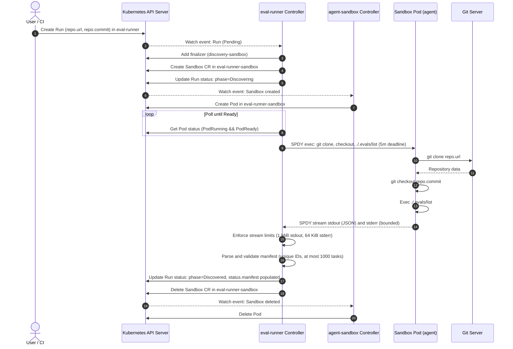

<!--
Copyright 2026 Google LLC

Licensed under the Apache License, Version 2.0 (the "License");
you may not use this file except in compliance with the License.
You may obtain a copy of the License at

    http://www.apache.org/licenses/LICENSE-2.0

Unless required by applicable law or agreed to in writing, software
distributed under the License is distributed on an "AS IS" BASIS,
WITHOUT WARRANTIES OR CONDITIONS OF ANY KIND, either express or implied.
See the License for the specific language governing permissions and
limitations under the License.
-->

# eval-runner Architecture

This document describes the architecture of `eval-runner` as implemented on `main` today.

Where [docs/concept/functionality.md](concept/functionality.md) describes the target end-state (including sample execution, statistical stopping rules, GitHub PR integration, and trajectory mining), this document records what is actually built and deployed today: discovery of eval manifests in isolated, zero-privilege sandboxes via `.evals/list`.

---

## 1. Components

The system consists of the following components running inside a Kubernetes cluster:

```
+---------------------------------------------------------------------------------+
| Kubernetes Cluster                                                              |
|                                                                                 |
|  +-----------------------------------+    +----------------------------------+  |
|  | Namespace: eval-runner            |    | Namespace: eval-runner-sandbox   |  |
|  |                                   |    |                                  |  |
|  |  +-----------------------------+  |    |  +----------------------------+  |  |
|  |  | Run CR                      |  |    |  | Sandbox CR                 |  |  |
|  |  | (evalrunner.gke-labs.dev)   |  |    |  | (agents.x-k8s.io/v1beta1)  |  |  |
|  |  +--------------+--------------+  |    |  +-------------+--------------+  |  |
|  |                 | watches/updates |    |                | creates/deletes |  |
|  |  +--------------v--------------+  |    |  +-------------v--------------+  |  |
|  |  | eval-runner Controller      +--------->| Discovery Pod (agent)      |  |  |
|  |  | (cmd/eval-runner)           |  SPDY |  | - alpine/git:v2.47.2       |  |  |
|  |  +-----------------------------+  exec |  | - automountToken: false    |  |  |
|  |                                   |    |  | - runAsUser: 1000          |  |  |
|  +-----------------------------------+    |  | - drop: [ALL]              |  |  |
|                                           |  | - seccomp: RuntimeDefault  |  |  |
|                                           |  +----------------------------+  |  |
|                                           +----------------------------------+  |
+---------------------------------------------------------------------------------+
```

### The Controller (`cmd/eval-runner`)

The controller is written in Go and built with [controller-runtime](https://github.com/kubernetes-sigs/controller-runtime) (v0.25.2). Its entrypoint is `cmd/eval-runner/main.go`.

Key implementation details:
- **Prerequisite validation**: On startup, before launching manager loops, the controller checks the Kubernetes API discovery client for the `Sandbox` resource in group `agents.x-k8s.io/v1beta1`. If the CRD is absent, it logs an error and exits immediately (`os.Exit(1)`).
- **Least-privilege caching**: The controller configures manager informers to cache only relevant objects in their specific namespaces:
  - `v1alpha1.Run` objects are cached solely in the controller namespace (`eval-runner`).
  - `sandboxv1beta1.Sandbox` and core `v1.Pod` objects are cached solely in the sandbox namespace (`eval-runner-sandbox`).
- **Health probes**: Exposes HTTP health endpoints on port `:8081` (`/healthz` and `/readyz`).
- **Pod execution**: Uses an `SPDYPodExecutor` backed by `k8s.io/client-go/tools/remotecommand` to stream `exec` commands into running sandbox containers.
- **Configurable limits**: Command-line flags `--max-stdout-bytes` (default: 1 MiB) and `--max-stderr-bytes` (default: 64 KiB) configure buffer caps for exec streams.

### The `Run` CRD (`evalrunner.gke-labs.dev/v1alpha1`)

The `Run` custom resource represents an evaluation request against a specific commit of a git repository:
- **Group/Version**: `evalrunner.gke-labs.dev/v1alpha1`
- **Kind**: `Run` (short name: `run`)
- **Scope**: Namespaced (`eval-runner`)
- **Specification (`spec`)**:
  - `repo.url`: The git clone URL for the repository under test.
  - `repo.commit`: The exact git commit SHA, strictly validated by the regex `^[0-9a-fA-F]{7,64}$`. Branch and tag names are rejected by CRD validation.
- **Status (`status`)**:
  - `phase`: Lifecycle phase: `Pending`, `Discovering`, `Discovered`, or `Failed`.
  - `message`: Human-readable status or bounded error description.
  - `conditions`: Kubernetes conditions, including condition `Discovered` (`True` or `False`).
  - `manifest`: Parsed manifest (`*Manifest`) populated when discovery succeeds, listing declared container images and eval tasks (`id`, `workdir`, `spec`, `resources`, `images`).
  - `discoveryDeadline`: Overall deadline (`metav1.Time`) by which discovery must complete, set at `Pending` -> `Discovering` and back-filled for in-flight Runs.
- **Finalizer**: `evalrunner.gke-labs.dev/discovery-sandbox` ensures discovery sandboxes in `eval-runner-sandbox` are cleaned up if a Run is deleted.

### Two Namespaces

The system is deployed into two distinct namespaces:
1. `eval-runner`: Hosts the controller Deployment, its ServiceAccount, and user-submitted `Run` custom resources.
2. `eval-runner-sandbox`: Hosts the untrusted `Sandbox` custom resources and their backing pods, plus fixture services during tests (e.g. `git-server`).

**Why they are separate:**
- **Workload isolation**: Sandboxes execute untrusted code checked out from arbitrary git repositories. Running them in a dedicated namespace prevents untrusted processes from interacting with controller resources or other system components.
- **Least-privilege RBAC**: The controller has distinct, namespaced permissions in each namespace (read/write `Run`s in `eval-runner`; create/delete `Sandbox`es and exec into pods in `eval-runner-sandbox`). Sandboxes themselves have no Kubernetes API access.
- **Informer scoping**: Restricts controller-runtime caches to only watch objects in the namespaces where they are expected.
- **Pod Security Admission (PSA)**: Both namespaces enforce the `restricted` PSA profile.

### Sandbox Primitive (`agent-sandbox`)

The controller relies on [kubernetes-sigs/agent-sandbox](https://github.com/kubernetes-sigs/agent-sandbox) (pinned release `v1.0.7`) as its sandbox abstraction.

The controller creates a `Sandbox` CR (`agents.x-k8s.io/v1beta1`) in `eval-runner-sandbox`. The name is deterministically derived as `discovery-<run-name>` (or a truncated name plus an 8-hex-character hash suffix if the name would exceed 63 characters). The `agent-sandbox` controller reconciles this CR and creates the underlying pod.

### Discovery Flow and State Machine

The reconciliation loop in `pkg/controller/run_controller.go` operates as a state machine:

```
[Create Run]
      |
      v
  (Pending) -------> Ensure finalizer
      |              Create Sandbox in eval-runner-sandbox
      v
(Discovering) -----> Wait for backing Pod Ready
      |              Exec clone & .evals/list (5m deadline)
      |              Enforce stdout (1 MiB) & stderr (64 KiB) limits
      |              Validate manifest
      |
      +------------> Success: Delete Sandbox, phase = Discovered
      |
      +------------> Failure: Delete Sandbox, phase = Failed (bounded message)
```

1. **Pending -> Discovering**:
   - The controller ensures the finalizer `evalrunner.gke-labs.dev/discovery-sandbox` is added to the `Run`.
   - The controller builds and creates the `Sandbox` CR in `eval-runner-sandbox`.
   - The Run status phase is updated to `Discovering` with condition `Discovered=False` (reason `Discovering`) and `status.discoveryDeadline` is recorded (default 10 minutes, configurable via `--discovery-deadline`).
2. **Waiting for Pod Ready**:
   - The controller watches both Sandbox and Pod resources in `eval-runner-sandbox`. The backing pod name is resolved via the `agents.x-k8s.io/pod-name` annotation with fallback to the sandbox name.
   - The overall discovery deadline check runs before checking whether the pod exists; if expired, the Run is failed immediately and the sandbox is cleaned up.
   - If the pod is not yet ready, the controller requeues after `min(2s, remaining deadline)`.
   - If the pod enters `PodFailed` or `PodSucceeded` unexpectedly, or if the Sandbox condition `Finished=True`, the Run transitions to `Failed`.
   - Readiness is satisfied via the Sandbox `Ready` condition OR backing pod readiness.
3. **Execution**:
   - Once the pod is ready, the controller executes the discovery command inside the `agent` container:
     ```sh
     rm -rf /tmp/repo && git clone -q -- "$1" /tmp/repo && cd /tmp/repo && git checkout -q "$2" && ./.evals/list
     ```
   - **Timeout**: The exec command context timeout is derived from the remaining discovery deadline budget (capped at `5*time.Minute`). Transient retry attempts and backoff sleep also respect this deadline.
4. **Output Capture and Limits**:
   - Exec streams are captured through `LimitWriter` instances (`pkg/discovery/limit_writer.go`).
   - If stdout exceeds 1 MiB (`MaxStdoutBytes`), output beyond the cap is discarded and the Run fails with a `LimitError` once the exec completes; cancelling the exec on trip is tracked in [#22](https://github.com/gke-labs/eval-runner/issues/22).
   - If stderr exceeds 64 KiB (`MaxStderrBytes`), output beyond the cap is discarded and the Run fails with a `LimitError` once the exec completes; cancelling the exec on trip is tracked in [#22](https://github.com/gke-labs/eval-runner/issues/22).
5. **Manifest Parsing and Validation**:
   - The stdout output is parsed as a JSON `Manifest` (`pkg/discovery/manifest.go`).
   - Validation enforces:
     - Manifest must not be nil.
     - `tasks` list must not be empty.
     - `tasks` count must not exceed 1,000 (`MaxTasks`).
     - Each task must have a non-empty, unique `id`.
     - Each task must have a non-empty `spec`.
6. **Completion**:
   - **On Success**: `status.phase` is set to `Discovered`, condition `Discovered=True` is recorded, `status.manifest` is populated, and the sandbox CR is deleted.
   - **On Failure**: `status.phase` is set to `Failed`, condition `Discovered=False` (reason `DiscoveryFailed`) is recorded, `status.message` is populated with the error description, pod phase, container waiting reasons/messages (e.g. `ImagePullBackOff`, `ErrImagePull`, `CreateContainerConfigError`), and `PodScheduled=False` reason for unschedulable pods, appended to any bounded stderr tail (up to 10 lines / 3 KiB; total message bounded to 4 KiB), and the sandbox CR is deleted.

### Finalizer-Based Cleanup

Kubernetes `ownerReferences` cannot cross namespace boundaries: a `Run` in `eval-runner` cannot be an owner reference for a `Sandbox` in `eval-runner-sandbox`.

To prevent orphaned sandboxes:
- The controller adds `evalrunner.gke-labs.dev/discovery-sandbox` to the `Run` before creating the sandbox.
- When a `Run` has a deletion timestamp, the controller locates the sandbox matching `evalrunner.gke-labs.dev/run-name` and `evalrunner.gke-labs.dev/run-namespace`, deletes it, removes the finalizer, and updates the Run.
- When a terminal Run (`Discovered` or `Failed`) is reconciled, any lingering sandbox matching the Run is cleaned up.

### Zero-Privilege Sandbox Specification

The discovery sandbox pod implements concept §3.2 ("empty resources = zero privilege"):
- **No ServiceAccount token**: `automountServiceAccountToken: false`. No token volume is projected.
- **Non-root**: `runAsNonRoot: true`, `runAsUser: 1000`, `runAsGroup: 1000`, `fsGroup: 1000`.
- **No privilege escalation**: `allowPrivilegeEscalation: false`.
- **Capabilities**: All Linux capabilities dropped (`drop: ["ALL"]`).
- **Seccomp**: `seccompProfile.type: RuntimeDefault`.
- **Pod Security Admission**: `eval-runner-sandbox` namespace is labeled with `pod-security.kubernetes.io/{enforce,warn,audit}: restricted`.
- **Pinned base image**: `alpine/git:v2.47.2`.
- **Resource requests and limits**: Requests 100m CPU / 128Mi RAM; limits 500m CPU / 512Mi RAM.

---

## 2. Sequence Diagram: Run Creation to Discovered

The following sequence diagram traces the complete lifecycle of a `Run` from submission to `Discovered`:



---

## 3. Trust Model

The trust model establishes strict boundaries around untrusted repository code:

```
[ Untrusted Sandbox ]                         [ Controller ]
(eval-runner-sandbox)                         (eval-runner)
+-------------------+                         +-------------------------+
| No SA Token       |                         | SA: eval-runner-controller
| UID 1000          |                         | Read-only rootfs        |
| Drop ALL caps     |                         | UID 65532 (nonroot)     |
| PSA restricted    |                         | Drops ALL caps          |
|                   |   SPDY exec (pull-only) |                         |
| .evals/list stdout+------------------------>| LimitWriter (1 MiB max) |
+-------------------+                         +-------------------------+
          |                                                |
          x (cannot access)                                v
    Kubernetes API                                Kubernetes API (namespaced RBAC)
```

### Credentials Matrix

| Component | ServiceAccount Token | Cloud / Git Secrets | Filesystem Access |
|---|---|---|---|
| **Controller Pod** | Mounted (`eval-runner-controller` in `eval-runner`) | None mounted | Read-only root filesystem (`readOnlyRootFilesystem: true`) |
| **Sandbox Pod** | **None** (`automountServiceAccountToken: false`) | **None** | Ephemeral container writable layer only |

### Reachability and Containment

- **The Sandbox has no credentials for the Kubernetes API**: Because `automountServiceAccountToken: false` is set and no kubeconfig is injected, untrusted code running inside the sandbox has no cluster identity or credentials (no SA token, no kubeconfig).
- **The Sandbox cannot push data**: The sandbox does not push results or logs. The controller connects to the pod via Kubernetes SPDY `remotecommand` exec and **pulls** stdout and stderr out.
- **Network reachability and egress**: There is no NetworkPolicy in `k8s/` today, so sandbox pod network egress is unrestricted: it has ordinary cluster network reachability (it can reach the Kubernetes API server and controller probe port `:8081`, though it lacks credentials to authenticate). It also has standard container network egress to clone repositories from Git (e.g. over HTTP/HTTPS or Git protocol). Adding a default-deny egress NetworkPolicy for `eval-runner-sandbox` (allowing only DNS and Git traffic) is tracked in issue [#33](https://github.com/gke-labs/eval-runner/issues/33).
- **Memory and API protection**: Even if `.evals/list` attempts a denial-of-service by printing gigabytes of output, the controller's `LimitWriter` cuts off consumption at 1 MiB for stdout and 64 KiB for stderr. This guarantees that status updates to the Kubernetes API server never exceed etcd's ~1.5 MiB request limit.

### Controller RBAC Permissions

The controller uses strictly namespaced RBAC with **no ClusterRole**:

1. **In namespace `eval-runner` (Role `eval-runner-controller`)**:
   - `evalrunner.gke-labs.dev/runs` and `runs/status`: `get`, `list`, `watch`, `update`, `patch`.
2. **In namespace `eval-runner-sandbox` (Role `eval-runner-controller-sandbox`)**:
   - `agents.x-k8s.io/sandboxes`: `create`, `get`, `list`, `watch`, `delete`.
   - Core `pods`: `get`, `list`, `watch`.
   - Core `pods/exec`: `create`.

The controller cannot create, read, or modify resources in any other namespace.

---

## 4. Deployment and Testing

### Deployment

The system is deployed using `ap` (autoproject):

```bash
IMAGE_PREFIX=<registry> ap deploy
```

- **Images under `images/`**:
  - `images/eval-runner/Dockerfile`: Multi-stage build producing a minimal distroless image (`gcr.io/distroless/static:nonroot`, user `65532:65532`).
  - `images/git-server/Dockerfile`: Fixture Git server image based on Alpine 3.21 running `git daemon`, serving the `examples/support-agent` repository for local and E2E testing.
- **Manifests under `k8s/`**:
  - `00-namespaces.yaml`: Declares `eval-runner` and `eval-runner-sandbox` namespaces with Pod Security Admission `restricted` labels.
  - `evalrunner.gke-labs.dev_runs.yaml`: CRD generated by `controller-gen`.
  - `rbac.yaml`: Namespaced ServiceAccounts, Roles, and RoleBindings.
  - `runner-deployment.yaml`: Controller Deployment configured with securityContext, health probes on `:8081`, and resource requests/limits.
- **Prerequisites**:
  - The `agent-sandbox` controller must be installed prior to deployment:
    ```bash
    kubectl apply -f https://github.com/kubernetes-sigs/agent-sandbox/releases/download/v1.0.7/sandbox.yaml
    ```

### Testing Strategy

The repository employs three testing tiers:

1. **Unit tests (`go test ./...` / `ap test`)**:
   - Runs fast in-memory unit tests without requiring Kubernetes.
   - Tests `pkg/discovery`: manifest parsing, validation (empty tasks, duplicate IDs, missing spec, task limits), limit writers, and sandbox specification building.
   - Tests `pkg/controller`: mock-executor-based reconciliation tests verifying state transitions (`Pending` -> `Discovering` -> `Discovered`/`Failed`), status update conflict retries, finalizer cleanup, and stream truncation.
2. **End-to-End tests (`tests/e2e/` via `ap e2e`)**:
   - Automated via `ap e2e` (or `./dev/tasks/test-e2e` followed by `RUN_E2E=1 go test ./tests/e2e/...`).
   - Runs against a local [Kind](https://kind.sigs.k8s.io/) cluster.
   - Automates downloading pinned versions of `kind` (v0.31.0) and `kubectl` (v1.35.0) into `.build/bin/`.
   - Automatically installs `agent-sandbox` v1.0.7, builds and loads images, deploys the controller and fixture `git-server`, and runs `TestRunDiscovery`.
   - Test cases in `tests/e2e/discovery_test.go`:
     - `DiscoveredSuccess`: Verifies full discovery of 3 tasks from `examples/support-agent`, status manifest population, and sandbox pod deletion.
     - `BadCommitFails`: Verifies failure handling on non-existent commit SHA and sandbox cleanup.
     - `DeleteMidDiscovery`: Verifies that deleting a Run while discovery is running invokes the finalizer and cleanly deletes the sandbox.
3. **Documentation Comprehension Evals (`./dev/tasks/test-evals`)**:
   - Dogfoods Inspect evals defined in `evals/docs_comprehension.py`.
   - Validates the root `.evals/list` manifest.
   - Executes offline evaluation tasks with Inspect's `mockllm/model` provider under `uv --locked` without requiring network or API keys.
   - Can be run against live LLMs (e.g. `google/gemini-3.5-flash-lite`) with `GEMINI_API_KEY`.

---

## 5. What Is Not Built Yet (Status Mapping)

The following table maps sections of the target product concept ([docs/concept/functionality.md](concept/functionality.md)) to their current status on `main`:

| Concept Section | Topic | Status | Related Issue / PR |
|---|---|---|---|
| **§2.1–§2.2** | Eval discovery via `.evals/list` | **Done** | Implemented in [#7](https://github.com/gke-labs/eval-runner/issues/7), [#9](https://github.com/gke-labs/eval-runner/pull/9) |
| **§2.3** | Inspect fallback when `.evals/list` absent | **Not started** | — |
| **§3.1, §3.3** | Discovery sandbox & zero privilege | **Done** | Implemented in [#7](https://github.com/gke-labs/eval-runner/issues/7), [#14](https://github.com/gke-labs/eval-runner/issues/14) |
| **§3.1, §3.4** | Sample execution in sandboxes | **In progress** | Issue [#26](https://github.com/gke-labs/eval-runner/issues/26) |
| **§3.2** | Empty resources (`[]` = zero privilege) | **Done** | Implemented in `pkg/discovery/sandbox.go` |
| **§3.2** | Declared resources (`docker`, `kind`, `kubernetes-namespace`, cloud projects) | **Not started** | — |
| **§4.1–§4.6** | Statistics (paired sampling, Wilson CI, stopping rule, verdicts, P(improvement)) | **In progress** | Issue [#25](https://github.com/gke-labs/eval-runner/issues/25), PR [#29](https://github.com/gke-labs/eval-runner/pull/29) |
| **§5.1–§5.4** | GitHub integration (check runs, updating PR comment, bot PRs) | **Not started** | — |
| **§6** | Trajectory storage (Inspect log format to user bucket) & viewer UI | **Not started** | Artifact sink interface planned in [#26](https://github.com/gke-labs/eval-runner/issues/26) |
| **§7** | Trajectory mining (automated skill fix generation) | **Not started** | — |
| **§8** | Fine-tunes (OpenRL training loop, continuum measurement, activation PRs) | **Not started** | — |
| **§9.1** | Evals from the wild (anonymised eval submission) | **Not started** | — |
| **§9.2** | Cohorts (tracking suite expansion over time) | **Not started** | — |
| **§10** | Continuum view (Pareto frontier scatter plot) | **Not started** | — |
| **§11** | Web application surfaces (Runs, Budget, Trajectories, Cohorts, Fine-tunes) | **Not started** | Mockups exist under `docs/concept/ui/` |

### Controller Enhancements in Flight

Several targeted enhancements to discovery and sandbox management are tracked in active issues:
- **Discovery deadline & pod waiting reasons**: Issue [#12](https://github.com/gke-labs/eval-runner/issues/12) / Issue [#41](https://github.com/gke-labs/eval-runner/issues/41) - Done.
- **Clone failure retry with backoff**: Issue [#20](https://github.com/gke-labs/eval-runner/issues/20) / PR [#21](https://github.com/gke-labs/eval-runner/pull/21).
- **Output limit exec cancellation**: Issue [#22](https://github.com/gke-labs/eval-runner/issues/22).
- **Finalizer NoMatch tolerance**: Issue [#23](https://github.com/gke-labs/eval-runner/issues/23).
- **Stderr tail on deadline expiry & injectable clock**: Issue [#24](https://github.com/gke-labs/eval-runner/issues/24).
- **Docs eval drift guard & evidence checks**: Issue [#27](https://github.com/gke-labs/eval-runner/issues/27).
- **Default-deny egress NetworkPolicy**: Issue [#33](https://github.com/gke-labs/eval-runner/issues/33).
